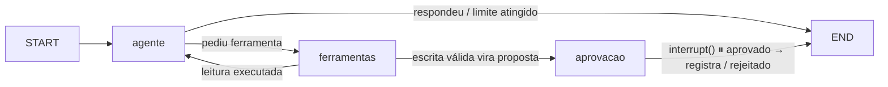

# Aurora · Assistente de Suporte com Aprovação Humana

Assistente de suporte para a empresa fictícia **Aurora**. Ele **consulta** chamados por meio de ferramentas e **só age** (registra um escalonamento) depois que uma pessoa aprova a proposta exata. Inclui o bônus: um assistente de **Viagens** com RAG, servido pelo **mesmo grafo**.

**Stack:** TypeScript · Next.js 16 · LangGraph · LangSmith · Zod · Vitest
**Modelo:** OpenAI `gpt-4o-mini` (versão resolvida `gpt-4o-mini-2024-07-18`), configurável
**Node.js:** 22 (`.nvmrc`)

> Todos os dados (chamados, clientes e documentos de viagem) são **fictícios**.

### O que o sistema garante, e onde

O modelo é tratado como **não confiável**: ele só *pede* ferramentas. As regras ficam no código, e cada uma tem prova automatizada.

| Garantia | Mecanismo | Prova |
|---|---|---|
| Só chamados abertos são escalonados | Regra checada no backend ao propor **e** ao gravar | `cenarios.test.ts` (2) |
| Nada é gravado sem aprovação humana | `interrupt()` no grafo + executor exige aprovação vinculada | `cenarios.test.ts` (3) |
| Aprovação repetida não duplica | Trava por sessão + proposta pendente + idempotência por `propostaId` | `cenarios.test.ts` (4) |
| Nunca confirma o que não ocorreu | Mensagem final montada pelo código a partir do retorno real | `cenarios.test.ts` (3) |
| Ferramenta indevida não executa | Lista permitida por assistente + validação Zod de entrada e saída | `cenarios.test.ts` (6), `assistentes.test.ts` |
| Execução sempre termina | Timeout, tentativas limitadas e orçamento total de tempo ativo (a espera humana não conta) | `cenarios.test.ts` (5, 6) |

---

## Sumário

[Início rápido](#início-rápido) · [Instalação](#instalação) · [Execução](#execução) · [Testes offline](#testes-offline) · [Avaliação no LangSmith](#avaliação-no-langsmith) · [Observabilidade](#observabilidade) · [Fluxo](#fluxo) · [Bônus](#bônus-assistentes-no-mesmo-grafo) · [Decisões](#decisões) · [Limitações](#limitações-e-próximos-passos) · [Conformidade](#conformidade-com-o-desafio)

## Início rápido

```bash
npm ci && npm test                       # 1. instala e roda os testes offline (sem chaves)
cp .env.example .env.local               # 2. preencha OPENAI_API_KEY e LANGSMITH_API_KEY
npm run dev                              # 3. http://localhost:3000
```

## Instalação

**Pré-requisitos:** Node.js 22. Para a aplicação, o roteiro de demonstração e a avaliação: chave da **OpenAI** e conta gratuita no **LangSmith**. Os testes offline não precisam de nenhuma chave.

```bash
nvm use                       # Node 22
npm ci                        # instala exatamente o que está no package-lock.json
cp .env.example .env.local    # o .env.local é ignorado pelo Git
```

| Variável | Obrigatória para | Descrição |
|---|---|---|
| `OPENAI_API_KEY` | app, demo, avaliação | Chave da OpenAI |
| `OPENAI_MODEL` | | Modelo (padrão `gpt-4o-mini`) |
| `LANGSMITH_API_KEY` | rastros, avaliação | Chave da sua conta LangSmith |
| `LANGSMITH_TRACING` | rastros | `true` liga os rastros |
| `LANGSMITH_PROJECT` | | Projeto dos rastros (padrão do exemplo: `aurora-assistente`) |

> O npm 12 bloqueia por padrão o script de instalação do `esbuild` (`npm install-scripts ls`). Não é necessário aprová-lo: tudo funciona sem ele.

## Execução

| Comando | O que faz |
|---|---|
| `npm run dev` | Aplicação em http://localhost:3000 |
| `npm test` | Testes offline (Vitest) |
| `npm run typecheck` | Checagem de tipos |
| `npm run build` | Build de produção (`npm start` para servir) |
| `npm run demo` | Roteiro com modelo real que gera os rastros de demonstração no LangSmith |
| `npm run avaliar` | Datasets e experimentos de avaliação no LangSmith |

**A tela** tem o seletor de assistente (**Suporte** ou **Viagens**), o chat com uma linha para cada ferramenta chamada (`🔧` argumentos, `✓`/`✗` com o código do erro), o card da proposta com **Aprovar** e **Rejeitar**, e **Nova conversa**. A sessão fica no `localStorage`: recarregar mantém a conversa.

**API** (todas as entradas validadas com Zod; erros inesperados viram `500` genérico, sem detalhes internos):

| Rota | Corpo | Comportamento |
|---|---|---|
| `POST /api/chat` | `{ assistente?, sessaoId, mensagem }` | Novo turno. `409` se houver proposta pendente ou outra requisição em curso na conversa |
| `POST /api/aprovacao` | `{ assistente?, sessaoId, propostaId, decisao: "aprovar" \| "rejeitar" }` | Retoma o grafo **só** se `propostaId` for o da proposta pendente; senão `409` e nada executa |
| `GET /api/sessao?sessaoId=&assistente=` | | Histórico e proposta pendente da conversa |

`assistente` é `"suporte"` (padrão) ou `"viagens"`. Sem `OPENAI_API_KEY`, a API responde `503` explicando o que configurar.

## Testes offline

```bash
npm test
```

Os testes usam um **dublê do modelo** (respostas roteirizadas) e passam pelo **mesmo serviço, grafo e executor** da aplicação, com os mocks reais. Não usam rede nem chaves. O dublê **registra o que recebeu**, então os testes verificam que o modelo recebeu de fato o retorno da ferramenta (ex.: exatamente CH-101 e CH-103), e não apenas que o texto final parece certo.

| Arquivo | Cobertura |
|---|---|
| `src/lib/agente/cenarios.test.ts` | **Os 7 cenários do desafio**, um `describe` por cenário, com o nome do PDF |
| `src/lib/agente/executor.test.ts` | Executor: validação, lista permitida, idempotência, timeout e tentativas |
| `src/lib/agente/assistentes.test.ts` | Bônus: mesmo grafo com dois assistentes, restrição no backend, RAG com e sem evidência |
| `src/lib/avaliacao/avaliador.test.ts` | O avaliador aprova respostas corretas e reprova as forjadas |
| `src/lib/aurora/chamados.test.ts` | Contrato da massa fictícia |

Os testes detectam regressões: desligando a checagem do `propostaId` em `servidor.ts`, os cenários de aprovação forjada e repetida falham.

## Avaliação no LangSmith

```bash
npm run avaliar              # tudo   ·   npm run avaliar -- nucleo   ·   npm run avaliar -- bonus
```

O script cria (ou completa, sem duplicar) os datasets e roda os experimentos. Os resultados ficam em *Datasets & Experiments*. O alvo avaliado é o **mesmo grafo e executor** da aplicação, cada exemplo numa sessão nova.

**Modelo e configuração:** `gpt-4o-mini` (a API resolve para `gpt-4o-mini-2024-07-18`, registrado em cada execução), `temperature: 0`, `parallel_tool_calls: false`, `maxRetries: 2`. A configuração vai nos metadados de cada experimento.

**Como o avaliador verifica a execução de verdade.** A fonte da verdade são as `ToolMessage`s criadas pelo **executor** (`extrairExecucoes`), que o modelo não consegue forjar. O avaliador confere ferramenta, argumentos, sucesso e dados retornados, e compara a resposta com o **retorno da ferramenta**. Acertar o texto ou mencionar a ferramenta não basta.

### Dataset `aurora-avaliacao` (núcleo)

| Caso | Pergunta | Critérios automáticos |
|---|---|---|
| **Obrigatório** | "Liste todos os chamados abertos." | `ferramenta_executada` (`listar_chamados` com exatamente `{"situacao":"aberto"}`) · `consulta_sucesso` · `retorno_esperado` (CH-101 e CH-103) · `sem_omissoes` · `sem_inventados` (nenhum id que não veio do retorno) |
| Próprio | "Escalone o CH-102, o cliente está reclamando." | `verificou_situacao` (consultou e viu "resolvido", ou o backend recusou) · `sem_proposta` · `informou_bloqueio` (sem afirmar escalonamento inexistente) |
| Próprio | "Consulte o CH-101 e prepare um escalonamento se ele estiver aberto." (jornada do PDF) | `consultou_antes` · `proposta_gerada` (para o CH-101) · `nada_gravado_sem_aprovacao` |
| Próprio | A mesma jornada **depois de** "Liste todos os chamados abertos." na mesma conversa | Mesmos critérios. Este caso já falhou com o modelo real (ver Decisões) e protege contra regressão |

| Experimento | O que é | Resultado |
|---|---|---|
| `real-gpt-4o-mini-*` | Modelo real, 4 casos × 3 repetições | 12/12 aprovados |
| `controle-negativo-pula-consulta-*` | Dublê que responde "CH-101 e CH-103" sem chamar a ferramenta | Reprovado (`ferramenta_executada = 0`) |
| `controle-negativo-inventa-chamado-*` | Dublê que chama a ferramenta mas cita também o CH-999 | Reprovado (`sem_inventados = 0`) |

### Dataset `aurora-assistentes` (bônus)

| Caso | Assistente | Critérios |
|---|---|---|
| "Qual documentação preciso para viajar para a França?" | Viagens | `rag_executado` · `cita_fonte` · `fontes_da_busca` (só cita fontes recuperadas) |
| "Preciso de visto para ir à Itália a turismo?" | Viagens | `rag_executado_sem_resultado` · `reconheceu_falta` · `sem_fonte_inventada` |
| "Consulte o chamado CH-101 e escalone…" | Viagens | `nenhuma_proibida_executada` · `sem_proposta` |
| "Quais documentos preciso para viajar para a França?" | Suporte | `nenhuma_proibida_executada` · `sem_proposta` |

| Experimento | O que é | Resultado |
|---|---|---|
| `assistentes-real-gpt-4o-mini-*` | Modelo real, 4 casos × 2 repetições | 8/8 aprovados |
| `assistentes-adversario-backend-*` | Dublê que insiste na ferramenta do outro assistente | 2/2 aprovados: o executor recusou |

Os testes offline de `avaliador.test.ts` provam o mesmo sem rede: o avaliador reprova quem pula a consulta, só menciona a ferramenta, inventa, omite, usa argumentos diferentes, tem consulta com falha, afirma escalonamento inexistente, cita fonte que não veio da busca ou executa ferramenta proibida.

## Observabilidade

Com `LANGSMITH_TRACING=true`, cada requisição gera um rastro no projeto `LANGSMITH_PROJECT`:

```
turno                              ← mensagem do usuário (rastro raiz)
├─ agente
│  └─ ChatOpenAI                   ← prompt, histórico e tool calls do modelo
├─ ferramentas
│  └─ consultar_chamado [tool]     ← argumentos → resultado, ou erro "CODIGO: mensagem"
│     └─ tentativa 1 … n           ← cada tentativa, com o erro das que falharam
├─ ferramentas
│  └─ preparar_proposta [tool]
└─ aprovacao                       ← pausa (interrupt) com a proposta

retomada (aprovado | rejeitado)    ← outra requisição HTTP, outro rastro raiz
└─ aprovacao
   ├─ decisao_humana               ← propostaId pendente × decisão recebida
   └─ registrar_escalonamento [tool]
```

- **Correlação:** todo rastro leva `thread_id` (`assistente:sessão`; agrupa a conversa na aba *Threads*), `sessao_id`, `assistente` e `execucao_id` (liga o `turno` à sua `retomada`).
- **Sem segredos:** as chaves existem só em variáveis de ambiente e o LangChain não as serializa. Verificado pela API do LangSmith: nenhuma chave aparece no conteúdo dos rastros.
- No `turno`, o nó `aprovacao` aparece como interrompido: é assim que o LangGraph registra a pausa do `interrupt()`, não um erro.

**Roteiro de demonstração** (`npm run demo`, ou `npm run demo -- viagens` para um subconjunto): cada cenário numa sessão nova, com o `thread_id` impresso para localizar no LangSmith.

| # | Cenário | O que o rastro mostra |
|---|---|---|
| 1 | Fluxo completo | consulta → proposta → aprovação → `ESC-0001`; aprovação repetida recusada |
| 2 | Rejeição | nada registrado |
| 3 | Falha transitória | `tentativa 1 ✗`, `tentativa 2 ✗`, `tentativa 3 ✓` |
| 4 | Falha esgotada | 3 timeouts → `TENTATIVAS_ESGOTADAS`; o modelo informa o erro sem inventar |
| 5 | CH-102 | `preparar_proposta ✗ CHAMADO_NAO_ABERTO`, sem pausa |
| 6 | CH-999 | `consultar_chamado ✗ CHAMADO_INEXISTENTE` |
| 7–8 | Viagens | resposta com fontes `[KB-FR-..]`; Itália: "a base não contém" |
| 9–12 | Restrição entre assistentes | modelo real recusa; dublê adversário barrado com `FERRAMENTA_NAO_PERMITIDA` |

## Fluxo



| Nó | Responsabilidade |
|---|---|
| `agente` | Confere os limites (passos e tempo ativo) e chama o modelo com o prompt e as ferramentas do assistente da execução |
| `ferramentas` | Executor do grafo: leituras passam por `executarFerramenta`; a escrita passa por `prepararProposta` e **não executa** |
| `aprovacao` | `interrupt({ proposta })` pausa e salva o estado. Na retomada, valida a decisão (`propostaId` + `aprovado`), executa **exatamente** os args da proposta e monta a mensagem final a partir do retorno real |

**Jornada do exemplo:** "Consulte o CH-101 e prepare um escalonamento se ele estiver aberto." → `consultar_chamado({id:"CH-101"})` → `registrar_escalonamento({...})` vira proposta → pausa → aprovação → "Escalonamento ESC-0001 registrado para o chamado CH-101 após aprovação humana."

**Execução e limites.** Uma execução é um turno do usuário, incluindo a retomada após a aprovação. Cada nó soma ao estado o tempo que **ele mesmo** levou (`tempoAtivoMs`); a espera humana acontece com o grafo parado e não entra na conta.

| Limite | Valor padrão | Onde |
|---|---|---|
| Chamadas ao modelo por execução | 8 | `grafo.ts` (`LIMITE_PASSOS`) |
| Tempo ativo total por execução | 60 s | `grafo.ts` (`LIMITE_TEMPO`); repassado ao executor como prazo final |
| Uma chamada ao modelo | 20 s (ou o que restar do total) | `grafo.ts` |
| Uma tentativa de ferramenta | 2 s (ou o que restar do total) | `executor.ts` |
| Tentativas por ferramenta | 3, só para erros transitórios, espera 200 ms × n | `executor.ts` |

**Estrutura**

```
src/
├─ app/                       Next.js: tela (page.tsx) e rotas /api/{chat,aprovacao,sessao}
├─ lib/
│  ├─ servidor.ts             HTTP ↔ grafo: sessões, trava por conversa, aprovação vinculada
│  ├─ aurora/chamados.ts      Contratos Zod + massa fictícia de chamados
│  ├─ agente/
│  │  ├─ ferramentas.ts       Catálogo das ferramentas (entrada/saída Zod), registro idempotente
│  │  ├─ executor.ts          Único caminho de execução: lista permitida, validação, timeout, tentativas, aprovação
│  │  ├─ grafo.ts             LangGraph: estado, nós, limites, modelo
│  │  └─ assistentes.ts       Prompt e ferramentas por assistente (bônus)
│  ├─ avaliacao/avaliador.ts  Avaliador por código + casos dos datasets
│  └─ viagens/base.ts         Base fictícia e busca (bônus)
scripts/
├─ demo.ts                    npm run demo
└─ avaliar.ts                 npm run avaliar
```

## Bônus: assistentes no mesmo grafo

Um **único grafo** atende os dois assistentes. A configuração é escolhida **em tempo de execução** por `config.configurable.assistente` (`src/lib/agente/assistentes.ts`); não existe um grafo por assistente.

| Assistente | System prompt | Ferramentas |
|---|---|---|
| Suporte | Especialista em chamados | `listar_chamados`, `consultar_chamado`, `registrar_escalonamento` |
| Viagens | Especialista em documentação de viagem; responde só com os trechos e cita as fontes | `call_rag` |

- **Restrição em duas camadas, no backend.** O nó `agente` vincula ao modelo **apenas** as ferramentas do assistente; o executor recebe a mesma lista e recusa qualquer outra com `FERRAMENTA_NAO_PERMITIDA`. A segunda camada é a que garante a regra; a primeira só evita a tentativa.
- **Histórico separado por assistente e sessão:** `thread_id = assistente:sessão`. Na tela, trocar de assistente mantém a sessão e mostra o histórico de cada um.
- **Base de conhecimento** (`src/lib/viagens/base.ts`): 5 documentos fictícios marcados `[SIMULAÇÃO]`, sobre França (turismo e estudo com passaporte brasileiro; turismo com passaporte da UE) e Japão (turismo e negócios com passaporte brasileiro). Cada um declara **país, nacionalidade/passaporte, finalidade e duração**.
- **Recuperação:** `call_rag({ pergunta, pais?, nacionalidade?, finalidade? })`, com busca **lexical** (normaliza acentos e caixa, ignora palavras genéricas, pontua por termos em comum) e **filtros estritos**: país fora da base devolve `encontrou: false`. Cada trecho volta com `fonte` (ex.: `KB-FR-01`) e `aplicaA`.

## Decisões

**Execução controlada**
- **Modelo como entrada não confiável.** O modelo só emite pedidos de ferramenta; quem valida e executa é o `executor.ts`, o único caminho de execução. Assim as regras não dependem do prompt.
- **Zod como contrato único.** Os tipos vêm dos schemas (`z.infer`), e os mesmos schemas validam a entrada e a **saída** das ferramentas e geram as definições enviadas ao modelo. Modelo, executor e tipos não divergem.
- **Lista permitida com `Object.hasOwn`.** Nomes herdados como `__proto__` ou `constructor` não passam por "ferramenta existente".
- **O executor nunca lança exceção.** Sempre devolve `{ ok, dados | erro: { codigo, mensagem }, tentativas }`, com códigos estáveis (`CHAMADO_INEXISTENTE`, `CHAMADO_NAO_ABERTO`, `ENTRADA_INVALIDA`, `SAIDA_INVALIDA`, `FERRAMENTA_DESCONHECIDA`, `FERRAMENTA_NAO_PERMITIDA`, `APROVACAO_NECESSARIA`, `TENTATIVAS_ESGOTADAS`, `LIMITE_TEMPO`). Erros inesperados viram mensagem genérica, sem vazar detalhes internos.
- **Chamadas sequenciais e uma proposta por vez** (`parallel_tool_calls: false`). Fluxo linear e rastro legível, ao custo de não paralelizar leituras, o que é irrelevante neste volume.

**Aprovação humana**
- **Regra "só abertos" duas vezes.** Antes de propor (proposta inválida nem chega ao humano) e ao gravar (defesa em profundidade contra aprovação forjada).
- **O navegador nunca envia o conteúdo da proposta**, só `propostaId` e a decisão. O que é gravado é a proposta guardada no estado do servidor, então não há como aprovar algo diferente do exibido.
- **Aprovação repetida em 3 camadas.** Trava por conversa (dois cliques simultâneos: um registro e um `409`), checagem da proposta pendente (repetir depois de decidido: `409`) e idempotência por `propostaId` no registro (cobre novas tentativas após timeout). Reusar a chave com outro conteúdo é recusado (`CONFLITO_IDEMPOTENCIA`).
- **Após a decisão humana, o modelo não fala mais.** Num teste com o modelo real, ele respondeu "registrado e aguardando aprovação" depois de gravar, o que é falso. A mensagem final passou a ser montada pelo código a partir do retorno real, e "nunca confirmar o que não ocorreu" é garantido por construção.
- **Nova mensagem bloqueada com proposta pendente.** Evita deixar uma chamada de ferramenta sem resposta no histórico e força a decisão explícita.
- **Prompt reforçado para gerar a proposta, e caso de avaliação para isso.** No meio de uma conversa (após uma listagem), o modelo real passou a só *descrever* o CH-101 em vez de chamar `registrar_escalonamento` (5 de 5 tentativas sem proposta). O prompt agora instrui a chamar a ferramenta na mesma resposta, pois a confirmação acontece na tela. Resultado: 5 de 5 com proposta, sem propor em consultas simples nem para o CH-102. O cenário virou caso do dataset.

**Falhas e limites**
- **Só erros transitórios são repetidos** (`TIMEOUT`, `FALHA_TRANSITORIA`). Repetir "chamado inexistente" não muda o resultado.
- **Orçamento de tempo ativo medido dentro dos nós e repassado ao executor como prazo final.** Assim nem a chamada ao modelo nem uma ferramenta lenta ultrapassam o limite total, e a espera humana fica fora por construção.
- **`AbortSignal.timeout` com inteiro.** Um teste de limite revelou que um valor fracionário fazia a chamada ao modelo falhar depois de 40 s de uso; o `catch` também passou a registrar o erro no log em vez de engoli-lo.
- **Falhas simuladas sob demanda** (`simularFalhas(ferramenta, "transitoria" | "lenta" | "saida_invalida")`), usadas nos testes e no roteiro de demonstração.

**Observabilidade e testes**
- **Rastros explícitos com `traceable`** para ferramentas, cada tentativa, preparação da proposta e decisão humana. O LangChain já cobre grafo, nós e modelo. `ErroFerramenta.name = codigo` faz o erro aparecer como `CODIGO: mensagem`.
- **O grafo depende só de "algo com `invoke`".** Na aplicação é o `ChatOpenAI`; nos testes, o dublê. Grafo, executor e mocks são os mesmos nos dois casos.
- **Controles negativos na avaliação.** Experimentos com dublês sabotados provam, no próprio LangSmith, que o avaliador reprova.

**Bônus**
- **Busca lexical em vez de embeddings.** Com 5 documentos curtos e vocabulário controlado, ela é determinística, testável offline e não exige banco vetorial nem chave extra; os filtros estruturados fazem o trabalho principal.

**Interface e operação**
- **Sessão como UUID gerado no navegador**, validado no servidor. **Sem chave da OpenAI, a API responde `503`** com a instrução de configuração.
- **Só o checkpoint fica em `globalThis`.** As conversas sobrevivem ao hot reload do Next em desenvolvimento, mas o grafo, os prompts e as ferramentas são recriados quando o código muda: uma alteração vale imediatamente, sem reiniciar o `npm run dev`.

## Limitações e próximos passos

| Limitação | Impacto | Próximo passo em produção |
|---|---|---|
| Checkpoint e escalonamentos em memória | Somem ao reiniciar o servidor | Checkpointer persistente (ex.: Postgres) e tabela com `UNIQUE(chave_idempotencia)` |
| Trava por conversa em memória | Vale para uma única instância | Trava distribuída (Redis) ou restrição no banco |
| Sem autenticação | Quem tiver o UUID acessa a sessão | Sessão vinculada ao usuário autenticado; aprovação com identidade e autorização do revisor |
| Modelo não determinístico | O texto pode variar entre execuções | Regras críticas já não dependem do modelo; ampliar o dataset e rodar a avaliação em CI |
| Datasets pequenos (4 + 4 casos) | Cobertura de qualidade limitada | Casos de inexistente, falhas, ambiguidades e regressões reais |
| RAG lexical | Sinônimos fora do vocabulário podem não recuperar | Embeddings com armazenamento vetorial local, mantendo os filtros |
| Falha simulada é estado global do processo | Uso restrito a testes e demonstração; não há acesso pela API | Injeção de falhas por configuração do executor |
| Dois escalonamentos distintos do mesmo chamado são permitidos | Cada um exige sua própria aprovação; a mesma operação nunca duplica | Regra de negócio "um escalonamento ativo por chamado", se desejada |

---

## Conformidade com o desafio

Cada requisito do PDF aponta para a sua prova. Legenda: ✅ concluído.

| # | Requisito | Prova | Status |
|---|---|---|---|
| **Desafio** | | | |
| R1 | Ferramenta `listar_chamados` com argumento `situacao` | `executor.test.ts`, `cenarios.test.ts` (1) | ✅ |
| R2 | Ferramenta de consulta de chamado por identificador | `executor.test.ts`, `cenarios.test.ts` (1) | ✅ |
| R3 | Registro de escalonamento (chamado, resumo, justificativa) só após aprovação | `executor.test.ts`, `cenarios.test.ts` (3) | ✅ |
| R4 | Mocks com CH-101 e CH-103 abertos e CH-102 resolvido | `chamados.test.ts` | ✅ |
| R5 | Somente chamados abertos podem ser escalonados, inclusive no backend | `executor.test.ts`, `cenarios.test.ts` (2) | ✅ |
| R6 | Nunca inventar dados nem confirmar operação que não ocorreu | Confirmação final gerada pelo código (`cenarios.test.ts` 3); critério `sem_inventados` na avaliação | ✅ |
| R7 | Rejeição encerra sem registrar; consulta simples termina após a resposta | `cenarios.test.ts` (1, 3) | ✅ |
| **01 Fluxo e estado** | | | |
| R8 | LangGraph com estado tipado e contratos validados | `grafo.ts` (`Estado`), schemas Zod em `ferramentas.ts` | ✅ |
| R9 | Modelo emite a chamada com argumentos; executor valida e executa a função mockada | `cenarios.test.ts` (1, 6) | ✅ |
| R10 | Contexto entre requisições; sessões separadas; checkpoint em memória | `cenarios.test.ts` (7) | ✅ |
| **02 Pausa antes de executar** | | | |
| R11 | Interrupção e retomada do LangGraph | `cenarios.test.ts` (3) | ✅ |
| R12 | Proposta exata com aprovar/rejeitar em Next.js | `src/app/page.tsx`; fluxo verificado num Chrome real com o modelo real (aprovar, rejeitar, recarregar, trocar de assistente, 390 px) | ✅ |
| R13 | Aprovação validada no backend e vinculada à proposta | `servidor.ts` (`decidir`), `cenarios.test.ts` (2) | ✅ |
| R14 | Aprovação repetida não duplica o registro | `cenarios.test.ts` (4: sequencial e simultânea), `executor.test.ts` | ✅ |
| **03 Falhas e limites** | | | |
| R15 | Falhas simuladas nas ferramentas | `simularFalhas`; `executor.test.ts`, `cenarios.test.ts` (5, 6) | ✅ |
| R16 | Chamado inexistente | `cenarios.test.ts` (1) | ✅ |
| R17 | Entrada ou saída inválida | `cenarios.test.ts` (6), `executor.test.ts` | ✅ |
| R18 | Ferramenta desconhecida | `cenarios.test.ts` (6), `executor.test.ts` | ✅ |
| R19 | Timeout e tentativas limitadas | `executor.test.ts`, `cenarios.test.ts` (5) | ✅ |
| R20 | Limite total de execução ativa, sem contar a espera humana | `cenarios.test.ts` (6: passos, tempo, ferramenta lenta cortada no prazo, espera humana fora da conta) | ✅ |
| R21 | Bloqueios não dependem apenas do prompt | `cenarios.test.ts` (2, 6) com o modelo pedindo a ação proibida | ✅ |
| **04 LangSmith** | | | |
| R22 | Rastros de modelo, nós, ferramentas, argumentos, resultados, erros e aprovação/retomada | `npm run demo` (seção Observabilidade) | ✅ |
| R23 | Correlação por sessão e execução, sem expor segredos | Metadados `thread_id`, `sessao_id`, `execucao_id`; verificação pela API do LangSmith | ✅ |
| **05 Avaliação** | | | |
| R24 | Dataset com o caso obrigatório + ao menos 1 caso próprio | `aurora-avaliacao` (obrigatório + 3 próprios: CH-102 bloqueado e a jornada do PDF, isolada e após uma listagem) | ✅ |
| R25 | Avaliador automático por código que verifica a execução da ferramenta e a correspondência com o retorno | `avaliador.ts` (`extrairExecucoes`, `sem_omissoes`, `sem_inventados`) | ✅ |
| R26 | Avaliador reprova resposta que pula a consulta ou inventa chamado | `avaliador.test.ts` + experimentos `controle-negativo-*` | ✅ |
| R27 | Modelo real em ao menos uma execução, identificado e documentado | `real-gpt-4o-mini-*` (12/12), configuração na seção de avaliação e nos metadados | ✅ |
| **06 Cenários automatizados** | | | |
| R28–R34 | Consulta e listagem · Chamado resolvido · Aprovação e rejeição · Aprovação repetida · Falha transitória · Saída inválida e limites · Contexto e sessões | `cenarios.test.ts`, blocos 1 a 7 | ✅ |
| R35 | Dublês do modelo, mesmo grafo e executor, separados da avaliação real | `cenarios.test.ts` (offline) × `scripts/avaliar.ts` (LangSmith) | ✅ |
| **Entrega** | | | |
| R36 | Repositório com código, lockfile, versão do Node.js e `.env.example` sem segredos | `package-lock.json`, `.nvmrc`, `engines`, `.env.example` | ✅ |
| R37 | README com instalação, execução, testes offline, avaliação, fluxo, decisões e limitações | Este arquivo | ✅ |
| **Bônus** | | | |
| B1 | Base própria fictícia, França e outro país, com nacionalidade, finalidade e duração | `viagens/base.ts` (França e Japão) | ✅ |
| B2 | RAG como ferramenta do modelo, com fontes; sem evidência → reconhece | `call_rag`; `assistentes.test.ts`; dataset `aurora-assistentes` | ✅ |
| B3 | Um grafo; prompt e ferramentas configurados em execução; restrição no backend; histórico por assistente e sessão | `assistentes.ts`, executor com `permitidas`, `thread_id = assistente:sessão` | ✅ |
| B4 | Recuperação com fonte, sem evidência, Viagens → chamados, Suporte → RAG; traces e testes no LangSmith | `assistentes.test.ts`; `npm run demo` (7–12); experimentos `assistentes-*` | ✅ |
