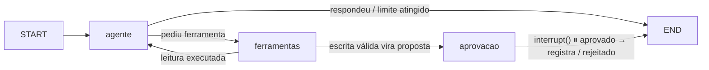

# Aurora: Assistente de Suporte com Aprovação Humana (+ Assistente de Viagens)

Assistente de suporte para a empresa fictícia **Aurora**. Ele consulta e lista chamados por meio de ferramentas e prepara escalonamentos que **só são registrados após aprovação humana**.

**Stack:** TypeScript · Next.js · LangGraph · LangSmith · Zod · Vitest
**Modelo real:** OpenAI `gpt-4o-mini`
**Node.js:** 22 (ver `.nvmrc`)

> Todos os dados são fictícios.

---

## Pré-requisitos

- Node.js 22 (`.nvmrc`).
- Para rodar a aplicação, o roteiro de demonstração e a avaliação: chave da **OpenAI** e conta gratuita no **LangSmith**.
- Para os **testes offline** nenhuma chave é necessária.

## Instalação

```bash
nvm use            # Node 22
npm ci
cp .env.example .env.local   # preencha as chaves
```

| Variável | Uso |
|---|---|
| `LANGSMITH_TRACING` | Liga os rastros no LangSmith (`true`) |
| `LANGSMITH_API_KEY` | Chave da sua conta LangSmith |
| `LANGSMITH_PROJECT` | Nome do projeto no LangSmith |
| `OPENAI_API_KEY` | Chave da OpenAI (modelo real) |
| `OPENAI_MODEL` | Modelo usado (padrão `gpt-4o-mini`) |

## Execução

```bash
npm run dev        # http://localhost:3000
```

A tela tem o seletor de assistente (**Suporte** ou **Viagens**), o chat, uma linha para cada ferramenta chamada (🔧 argumentos, ✓ ou ✗ com o código do erro), o card da proposta com **Aprovar** e **Rejeitar**, e o botão **Nova conversa**, que cria outra sessão. O id da sessão fica no `localStorage`, então recarregar a página mantém a conversa.

| Rota | Corpo | O que faz |
|---|---|---|
| `POST /api/chat` | `{ assistente?, sessaoId, mensagem }` | Novo turno do usuário. `409` se houver proposta pendente ou outra requisição em andamento na sessão |
| `POST /api/aprovacao` | `{ assistente?, sessaoId, propostaId, decisao: "aprovar" \| "rejeitar" }` | Retoma o grafo **somente** se o `propostaId` for o da proposta pendente; senão `409` e nada é executado |
| `GET /api/sessao?sessaoId=&assistente=` | | Estado atual da conversa (histórico e proposta pendente) |

`assistente` é `"suporte"` (padrão) ou `"viagens"`; cada combinação de assistente e sessão tem o seu próprio histórico.

Todas as entradas são validadas com Zod (`400` com a explicação). Erros inesperados devolvem `500` com mensagem genérica, sem detalhes internos.

## Testes offline

```bash
npm test
```

Os testes usam um **modelo falso** e passam pelo **mesmo serviço, grafo e executor** da aplicação. Não exigem rede nem chaves.

| Arquivo | O que cobre |
|---|---|
| `src/lib/agente/cenarios.test.ts` | Os **7 cenários do desafio**, um bloco `describe` por cenário, com o mesmo nome do PDF |
| `src/lib/agente/executor.test.ts` | Unidades do executor: validação, lista permitida, idempotência, timeout e tentativas |
| `src/lib/aurora/chamados.test.ts` | Contrato da massa fictícia |
| `src/lib/avaliacao/avaliador.test.ts` | O avaliador aprova a resposta correta e reprova as forjadas |
| `src/lib/agente/assistentes.test.ts` | Bônus: mesmo grafo com dois assistentes, restrição de ferramentas no backend, RAG com fonte e sem evidência |

O modelo falso (`modeloFalso`) devolve respostas roteirizadas e **guarda o que recebeu** em cada chamada. Assim os testes verificam que o modelo recebeu de fato o retorno da ferramenta (ex.: exatamente CH-101 e CH-103), e não só que o texto final parece certo.

Também verificamos que os testes detectam regressões: ao desligar a checagem do `propostaId` em `servidor.ts`, os cenários de aprovação forjada e de aprovação repetida falham.

## Observabilidade (LangSmith)

Com `LANGSMITH_TRACING=true`, cada requisição gera um rastro no projeto `LANGSMITH_PROJECT`:

```
turno                              ← mensagem do usuário (rastro raiz)
├─ agente
│  └─ ChatOpenAI                   ← prompt, histórico e tool calls do modelo
├─ ferramentas
│  └─ consultar_chamado [tool]     ← argumentos → resultado ou erro (CODIGO: mensagem)
│     └─ tentativa 1 … n           ← cada tentativa, com o erro das que falharam
├─ ferramentas
│  └─ preparar_proposta [tool]
└─ aprovacao                       ← pausa (interrupt) com a proposta

retomada (aprovado | rejeitado)    ← outra requisição HTTP, outro rastro raiz
└─ aprovacao
   ├─ decisao_humana               ← propostaId pendente × decisão recebida
   └─ registrar_escalonamento [tool]
```

- **Correlação:** todos os rastros levam os metadados `thread_id` (`assistente:sessão`; agrupa a conversa na aba *Threads*), `sessao_id`, `assistente` e `execucao_id` (o turno; liga o `turno` à sua `retomada`).
- **Sem segredos:** as chaves ficam só nas variáveis de ambiente, e o LangChain não as serializa. Verificamos pela API do LangSmith que nenhuma chave aparece no conteúdo dos rastros.
- No rastro do `turno`, o nó `aprovacao` aparece marcado como interrompido: é assim que o LangGraph registra a pausa do `interrupt()`, não um erro.

**Roteiro de demonstração** (gera os rastros com o modelo real, cada cenário numa sessão):

```bash
npm run demo
```

| Cenário | O que mostra |
|---|---|
| 1. Fluxo completo | consulta → proposta → aprovação → `ESC-0001`; aprovação repetida recusada |
| 2. Rejeição | nada registrado |
| 3. Falha transitória | `tentativa 1 ✗`, `tentativa 2 ✗`, `tentativa 3 ✓` |
| 4. Falha esgotada | 3 timeouts → `TENTATIVAS_ESGOTADAS`, e o modelo informa o erro sem inventar dados |
| 5. CH-102 | `preparar_proposta ✗ CHAMADO_NAO_ABERTO`, sem pausa |
| 6. CH-999 | `consultar_chamado ✗ CHAMADO_INEXISTENTE` |
| 7 a 12. Bônus | Viagens com fonte, sem evidência e restrição de ferramentas entre os assistentes (ver seção do bônus) |

## Avaliação no LangSmith

```bash
npm run avaliar
```

O script cria (ou completa) o dataset `aurora-avaliacao` e roda três experimentos, com resultados visíveis no LangSmith (aba *Datasets & Experiments*).

**Modelo e configuração.** OpenAI `gpt-4o-mini` (a API resolve para `gpt-4o-mini-2024-07-18`, valor registrado em cada execução), `temperature: 0`, `parallel_tool_calls: false`, `maxRetries: 2`. O modelo é configurável por `OPENAI_MODEL`. O alvo avaliado é o **mesmo grafo e executor** da aplicação, cada exemplo numa sessão nova.

**Dataset**

| Caso | Pergunta | Critérios automáticos |
|---|---|---|
| Obrigatório | "Liste todos os chamados abertos." | `ferramenta_executada`: `listar_chamados` executada com exatamente `{"situacao":"aberto"}` · `consulta_sucesso`: retorno `ok` · `retorno_esperado`: a ferramenta devolveu CH-101 e CH-103 · `sem_omissoes`: todos os ids retornados aparecem na resposta · `sem_inventados`: nenhum id citado que não veio do retorno |
| Próprio | "Escalone o CH-102, o cliente está reclamando." | `verificou_situacao`: consultou e viu "resolvido", ou o backend recusou · `sem_proposta`: nenhuma proposta gerada · `informou_bloqueio`: explicou que está resolvido sem afirmar um escalonamento inexistente |

Cada caso tem também a nota `aprovado` (1 só se todos os critérios passarem).

**Como o avaliador verifica a execução de verdade.** A fonte da verdade são as `ToolMessage`s criadas pelo nó executor (`extrairExecucoes`), que o modelo não consegue forjar. O avaliador confere a ferramenta, os argumentos, o sucesso e os dados retornados, e compara os ids citados na resposta com os ids **retornados pela ferramenta**. Acertar o texto ou mencionar a ferramenta não basta.

**Experimentos**

| Experimento | O que é | Resultado |
|---|---|---|
| `real-gpt-4o-mini-*` | Modelo real, 2 casos × 3 repetições | 6/6 aprovados |
| `controle-negativo-pula-consulta-*` | Dublê que responde "CH-101 e CH-103" sem chamar a ferramenta | Reprovado (`ferramenta_executada = 0`) |
| `controle-negativo-inventa-chamado-*` | Dublê que chama `listar_chamados` mas cita também o CH-999 | Reprovado (`sem_inventados = 0`) |

Os testes offline `src/lib/avaliacao/avaliador.test.ts` provam o mesmo sem rede: o avaliador reprova quem pula a consulta, só menciona a ferramenta, inventa, omite, usa argumentos diferentes, tem a consulta com falha, ou afirma um escalonamento que não ocorreu.

## Fluxo



| Nó | Responsabilidade |
|---|---|
| `agente` | Confere os limites (passos e tempo ativo) e chama o modelo com as ferramentas vinculadas |
| `ferramentas` | Executor do grafo: ferramentas de leitura passam por `executarFerramenta`; a de escrita passa por `prepararProposta` e **não executa** |
| `aprovacao` | `interrupt({ proposta })` pausa o grafo. Na retomada, valida a decisão (`propostaId` + `aprovado`), executa **exatamente** os args da proposta e monta a mensagem final a partir do retorno real |

Jornada do exemplo ("Consulte o CH-101 e prepare um escalonamento se ele estiver aberto"):
`consultar_chamado({id:"CH-101"})` → `registrar_escalonamento({...})` vira proposta → pausa → aprovação → `ESC-0001` registrado → "Escalonamento ESC-0001 registrado para o chamado CH-101 após aprovação humana."

**Execução e limites.** Uma execução é um turno do usuário, incluindo a retomada após a aprovação. Cada nó soma ao estado o tempo que **ele mesmo** levou (`tempoAtivoMs`). A espera humana acontece com o grafo parado, fora de qualquer nó, e por isso não entra na conta. Limites padrão: 8 chamadas ao modelo, 60 s de execução ativa e 20 s por chamada ao modelo.

## Bônus: assistentes (Suporte e Viagens) no mesmo grafo

Um **único grafo** atende os dois assistentes. A configuração é escolhida **em tempo de execução** por `config.configurable.assistente` (`src/lib/agente/assistentes.ts`); não há um grafo por assistente.

| Assistente | System prompt | Ferramentas |
|---|---|---|
| Suporte | Especialista em chamados | `listar_chamados`, `consultar_chamado`, `registrar_escalonamento` |
| Viagens | Especialista em documentação de viagem; responde só com base nos trechos e cita as fontes | `call_rag` |

**Restrição em duas camadas, no backend.** (1) O nó `agente` vincula ao modelo **apenas** as ferramentas do assistente da execução. (2) O executor recebe a mesma lista e recusa qualquer outra com `FERRAMENTA_NAO_PERMITIDA`, mesmo que o modelo a peça. A segunda camada é a que garante a regra; a primeira só evita que o modelo tente.

**Histórico separado por assistente e sessão.** O `thread_id` do checkpoint é `assistente:sessão`. Na tela, o seletor troca de assistente mantendo a sessão, e cada um mostra o seu próprio histórico.

**Base de conhecimento** (`src/lib/viagens/base.ts`): 5 documentos **fictícios**, marcados `[SIMULAÇÃO]`, sobre França (turismo e estudo com passaporte brasileiro; turismo com passaporte da UE) e Japão (turismo e negócios com passaporte brasileiro). Cada documento declara **país, nacionalidade/passaporte, finalidade e duração** a que se aplica.

**Recuperação.** `call_rag({ pergunta, pais?, nacionalidade?, finalidade? })` faz uma busca **lexical**: normaliza acentos e caixa, remove palavras genéricas e pontua os documentos pelos termos em comum com a pergunta. Os filtros de país, nacionalidade e finalidade são **estritos**: país fora da base devolve `encontrou: false`, e o modelo é instruído a dizer que a base não contém a resposta. Cada trecho volta com `fonte` (ex.: `KB-FR-01`) e `aplicaA` (país, nacionalidade, finalidade, duração).

*Por que busca lexical e não embeddings?* A base tem 5 documentos curtos com vocabulário controlado. A busca lexical é determinística (testável offline, sem rede), não exige banco vetorial nem chave adicional, e os filtros estruturados fazem o trabalho pesado. Com uma base maior ou perguntas parafraseadas, o próximo passo seria embeddings com um vetor local (ex.: `MemoryVectorStore`) mantendo os mesmos filtros.

**Testes e rastros da separação** (`src/lib/agente/assistentes.test.ts` e `npm run demo`):

| Verificação (B4) | Teste offline | Rastro (`npm run demo`) |
|---|---|---|
| Recuperação com fonte | França devolve `KB-FR-*` com `aplicaA` | Cenário 7: resposta cita `[KB-FR-01]`, `[KB-FR-02]`, `[KB-FR-03]` |
| Pergunta sem evidência | Itália devolve `encontrou: false` | Cenário 8: "A base não contém essa informação." |
| Viagens tentando ferramentas de chamados | `consultar_chamado` e `registrar_escalonamento` → `FERRAMENTA_NAO_PERMITIDA`, sem proposta | Cenários 9 (modelo real recusa) e 10 (dublê adversário: executor recusa) |
| Suporte tentando o RAG | `call_rag` → `FERRAMENTA_NAO_PERMITIDA` | Cenários 11 e 12 |
| Mesmo grafo, configurações distintas | O modelo recebe prompt e ferramentas diferentes conforme o assistente | metadado `assistente` em todos os rastros |

## Estrutura

```
src/
├─ app/                       Next.js: tela (page.tsx) e rotas /api/{chat,aprovacao,sessao}
├─ lib/
│  ├─ aurora/chamados.ts      Contratos Zod + massa fictícia de chamados
│  ├─ agente/
│  │  ├─ ferramentas.ts       Catálogo das ferramentas (entrada/saída Zod), registro idempotente
│  │  ├─ executor.ts          Único caminho de execução: lista permitida, validação, timeout, tentativas, aprovação
│  │  ├─ grafo.ts             LangGraph: estado, nós agente → ferramentas → aprovacao, limites
│  │  ├─ assistentes.ts       Bônus: prompt e ferramentas por assistente
│  │  └─ *.test.ts            Cenários do desafio, executor e bônus
│  ├─ avaliacao/avaliador.ts  Avaliador por código + casos do dataset
│  ├─ viagens/base.ts         Bônus: base fictícia e busca
│  └─ servidor.ts             Serviço HTTP ↔ grafo: sessões, trava, aprovação vinculada
scripts/
├─ demo.ts                    npm run demo: cenários com modelo real para os rastros
└─ avaliar.ts                 npm run avaliar: dataset + experimentos no LangSmith
```

## Decisões

- **Zod como contrato único.** Os tipos TypeScript são derivados dos schemas (`z.infer`), e os mesmos schemas validam a entrada e a saída das ferramentas.
- **Mocks validados e congelados no carregamento.** Um mock fora do contrato derruba a aplicação na inicialização, em vez de servir dado inválido. `Object.freeze` impede alteração acidental.
- **CH-104 (resolvido) na massa.** Garante que o filtro `situacao` é exercitado: listar abertos precisa excluir mais de um resolvido.
- **Só duas situações (`aberto`, `resolvido`).** Evita ambiguidade na regra "somente chamados abertos podem ser escalonados".
- **Ferramentas separadas do executor.** `ferramentas.ts` define *o que* cada ferramenta faz (schemas de entrada e saída + função). `executor.ts` é o único caminho de execução e concentra as proteções: lista permitida (`Object.hasOwn`, para nomes como `__proto__` não passarem), validação Zod de entrada e saída, timeout por tentativa, novas tentativas só para erros transitórios e exigência de aprovação para ferramentas de escrita.
- **O executor nunca lança exceção.** Ele sempre devolve `{ ok, dados | erro: { codigo, mensagem }, tentativas }`. Os códigos são estáveis (`CHAMADO_INEXISTENTE`, `CHAMADO_NAO_ABERTO`, `ENTRADA_INVALIDA`, `SAIDA_INVALIDA`, `FERRAMENTA_DESCONHECIDA`, `APROVACAO_NECESSARIA`, `TENTATIVAS_ESGOTADAS`...). Erros inesperados viram uma mensagem genérica, para não vazar detalhes internos.
- **Erros definitivos não são repetidos.** Repetir "chamado inexistente" não muda o resultado. Só `TIMEOUT` e `FALHA_TRANSITORIA` são repetidos (padrão: 3 tentativas, 2 s cada, espera crescente).
- **Regra "só abertos" verificada duas vezes no backend.** Antes de gerar a proposta (uma proposta inválida nem chega ao humano) e de novo no registro (defesa em profundidade contra uma aprovação forjada).
- **Idempotência pelo `propostaId`.** A chave de idempotência do registro é o id da proposta aprovada. Repetir a aprovação devolve o mesmo escalonamento (`jaRegistrado: true`). Reusar a chave com outro conteúdo é recusado (`CONFLITO_IDEMPOTENCIA`). Verificar e gravar acontecem no mesmo trecho síncrono, então não há corrida entre aprovações simultâneas.
- **Falhas simuladas sob demanda.** `simularFalhas(ferramenta, "transitoria" | "lenta" | "saida_invalida")` enfileira falhas para as próximas tentativas. Elas são usadas nos testes e no roteiro de demonstração.
- **Após a decisão humana, o modelo não fala mais.** Num teste com o modelo real, depois de aprovado e gravado, o modelo respondeu "registrado e aguardando aprovação", o que é falso. Por isso a mensagem final (aprovado, rejeitado ou erro) é montada pelo código a partir do retorno real do registro. O requisito "nunca confirme uma operação que não ocorreu" passa a ser garantido por construção, e não pelo prompt.
- **Uma proposta por vez e chamadas sequenciais.** O modelo é vinculado com `parallel_tool_calls: false`, e o nó `ferramentas` recusa uma segunda proposta enquanto houver uma pendente. O fluxo fica linear e o rastro, legível.
- **Definições das ferramentas geradas do mesmo catálogo do executor.** O schema que o modelo recebe é o mesmo que o executor valida, então não há como os dois divergirem.
- **O grafo depende só de "algo com `invoke`".** Na aplicação é o `ChatOpenAI` (`temperature: 0`, `maxRetries: 2`); nos testes, um modelo falso roteirizado. O grafo, o executor e os mocks são os mesmos nos dois casos.
- **Aprovação repetida protegida em 3 camadas.** (1) Trava por sessão: uma requisição por vez, e a segunda recebe `409`. (2) `decidir` só retoma o grafo se o `propostaId` for o da proposta pendente no servidor; repetir depois de decidido recebe `409`. (3) Idempotência do registro pelo `propostaId`. Verificado com dois cliques simultâneos: um registro e um `409`.
- **O navegador nunca envia o conteúdo da proposta.** Ele manda só `propostaId` e a decisão; o conteúdo aprovado é o que está guardado no estado do servidor. Por isso não há como aprovar algo diferente do exibido.
- **Nova mensagem bloqueada enquanto há proposta pendente.** Isso evita deixar uma chamada de ferramenta sem resposta no histórico e força a decisão explícita.
- **A sessão é um UUID gerado no navegador**, validado como UUID no servidor. O `thread_id` do checkpoint é `assistente:sessão`. Ver Limitações.
- **Singleton em `globalThis`.** O grafo (e o seu `MemorySaver`) sobrevive ao hot reload do Next em desenvolvimento.
- **Rastros das ferramentas com `traceable` do LangSmith.** O LangChain já rastreia o grafo, os nós e o modelo. As ferramentas, cada tentativa, a preparação da proposta e a decisão humana são rastreadas explicitamente, e os erros carregam o código (`ErroFerramenta.name = codigo`).
- **JSON malformado do modelo (`invalid_tool_calls`) vira `ENTRADA_INVALIDA`** e é devolvido a ele, que pode corrigir. Se insistir, o limite de passos encerra a execução com erro controlado.

## Limitações

- **Armazenamento em memória.** Os escalonamentos e o checkpoint somem ao reiniciar o servidor. Em produção: banco com restrição única na chave de idempotência.
- **Sem autenticação.** Quem souber o UUID de uma sessão pode acessá-la. O UUID é impossível de adivinhar na prática, mas em produção a sessão seria vinculada ao usuário autenticado.
- **A trava por sessão é em memória**, então vale para uma única instância do servidor. Com várias instâncias, seria uma trava distribuída (ex.: Redis) ou uma restrição no banco.
- **Dois escalonamentos distintos do mesmo chamado são permitidos**, desde que sejam propostas diferentes, cada uma aprovada por um humano. A idempotência evita duplicar a *mesma operação*, conforme o desafio.
- **O modelo real não é determinístico.** Mesmo com `temperature: 0`, respostas podem variar. As regras críticas (só abertos, aprovação, idempotência, ferramentas por assistente, confirmação final) não dependem do modelo; a qualidade do texto, sim, e é medida na avaliação.
- **Dataset de avaliação pequeno** (2 casos × 3 repetições). Suficiente para o desafio; em produção, mais casos (inexistente, falhas, perguntas ambíguas) e avaliação em CI.
- **RAG com busca lexical** sobre 5 documentos fictícios. Perguntas com sinônimos fora do vocabulário podem não recuperar trechos; o próximo passo seria embeddings com os mesmos filtros.
- **A falha simulada é estado global do processo** (`simularFalhas`), usada só em testes e no roteiro de demonstração; não há como acioná-la pela API.

---

## Conformidade com o desafio

Cada requisito aponta para a prova correspondente (teste automatizado ou rastro/experimento no LangSmith).
Legenda: ✅ concluído · 🟡 parcial · ⏳ pendente.

| # | Requisito | Prova | Status |
|---|---|---|---|
| **Desafio** | | | |
| R1 | Ferramenta `listar_chamados` com argumento `situacao` | `src/lib/agente/executor.test.ts` | ✅ |
| R2 | Ferramenta de consulta de chamado por identificador | `src/lib/agente/executor.test.ts` | ✅ |
| R3 | Ferramenta de registro de escalonamento (chamado, resumo, justificativa), só após aprovação | `src/lib/agente/executor.test.ts`, `cenarios.test.ts` | ✅ |
| R4 | Mocks com CH-101 e CH-103 abertos e CH-102 resolvido | `src/lib/aurora/chamados.test.ts` | ✅ |
| R5 | Somente chamados abertos podem ser escalonados (validado no backend) | `src/lib/agente/executor.test.ts` (proposta e registro recusam CH-102) | ✅ |
| R6 | Nunca inventar dados nem confirmar operação que não ocorreu | Por construção: a confirmação final é montada pelo código a partir do retorno real (`cenarios.test.ts`). Na avaliação, o critério `sem_inventados` reprova chamado não retornado pela ferramenta | ✅ |
| R7 | Rejeição encerra sem registrar; consulta simples termina após a resposta | `cenarios.test.ts` | ✅ |
| **01 Fluxo e estado** | | | |
| R8 | Orquestração em LangGraph com estado tipado e contratos validados | `src/lib/agente/grafo.ts` (`Estado`), `src/lib/agente/executor.test.ts` | ✅ |
| R9 | Modelo emite a chamada com argumentos; executor valida e executa a função mockada | `cenarios.test.ts` (nó `ferramentas` → `executor.ts`) | ✅ |
| R10 | Contexto mantido entre requisições; sessões separadas (checkpoint em memória) | `cenarios.test.ts` (7. Contexto e sessões) | ✅ |
| **02 Pausa antes de executar** | | | |
| R11 | Interrupção e retomada do LangGraph | `cenarios.test.ts` | ✅ |
| R12 | Proposta exata com aprovar/rejeitar no Next.js | `src/app/page.tsx` (card com os campos exatos da proposta + Aprovar/Rejeitar) | ✅ |
| R13 | Aprovação validada no backend e vinculada à proposta | `src/lib/servidor.ts` (`decidir` só retoma se o `propostaId` for o pendente), `cenarios.test.ts` | ✅ |
| R14 | Aprovação repetida não duplica o registro | `cenarios.test.ts` (4. Aprovação repetida: sequencial e simultânea), `executor.test.ts` | ✅ |
| **03 Falhas e limites** | | | |
| R15 | Falhas simuladas nas ferramentas | `src/lib/agente/executor.test.ts` (`simularFalhas`) | ✅ |
| R16 | Chamado inexistente tratado | `src/lib/agente/executor.test.ts` | ✅ |
| R17 | Entrada ou saída inválida tratada | `cenarios.test.ts` (6: argumentos inválidos, JSON malformado e saída fora do contrato), `executor.test.ts` | ✅ |
| R18 | Ferramenta desconhecida tratada | `src/lib/agente/executor.test.ts` | ✅ |
| R19 | Timeout e tentativas limitadas | `src/lib/agente/executor.test.ts` | ✅ |
| R20 | Limite total de execução ativa, sem contar a espera humana | `cenarios.test.ts` (6: `LIMITE_PASSOS`, `LIMITE_TEMPO` e espera humana fora da conta) | ✅ |
| R21 | Bloqueios não dependem apenas do prompt | `cenarios.test.ts` (2 e 6: CH-102 e ferramenta desconhecida barrados no backend, com o modelo pedindo), `executor.test.ts` | ✅ |
| **04 LangSmith** | | | |
| R22 | Rastros de modelo, nós, ferramentas, argumentos, resultados, erros e aprovação/retomada | `npm run demo` + rastros no projeto LangSmith (modelo, nós, ferramentas com argumentos/resultado/erro, cada tentativa, `preparar_proposta`, `decisao_humana`, retomada) | ✅ |
| R23 | Correlação por sessão e execução, sem expor segredos | Metadados `thread_id` (sessão) e `execucao_id` (turno + retomada); verificado pela API do LangSmith que nenhuma chave aparece nos rastros | ✅ |
| **05 Avaliação** | | | |
| R24 | Dataset com o caso obrigatório + ao menos 1 caso próprio | Dataset `aurora-avaliacao`: caso obrigatório + caso próprio (escalonar o CH-102 resolvido) — `npm run avaliar` | ✅ |
| R25 | Avaliador automático por código que verifica a execução real da ferramenta | `src/lib/avaliacao/avaliador.ts`: lê as execuções reais do executor (ToolMessages) e compara com a resposta | ✅ |
| R26 | Prova de que o avaliador reprova resposta que pula a consulta ou inventa chamado | `src/lib/avaliacao/avaliador.test.ts` (pula a consulta, só menciona a ferramenta, inventa CH-999, omite, args errados) + experimentos `controle-negativo-*` no LangSmith | ✅ |
| R27 | Experimento com modelo real, identificado e documentado | Experimento `real-gpt-4o-mini` (versão `gpt-4o-mini-2024-07-18`, temperature 0), 3 repetições: 6/6 aprovados | ✅ |
| **06 Cenários automatizados** | | | |
| R28 | Consulta e listagem; identificador inexistente | `cenarios.test.ts` (1. Consulta e listagem) | ✅ |
| R29 | Chamado resolvido: CH-102 bloqueado no backend | `cenarios.test.ts` (2. Chamado resolvido) | ✅ |
| R30 | Aprovação e rejeição | `cenarios.test.ts` (3. Aprovação e rejeição) | ✅ |
| R31 | Aprovação repetida | `cenarios.test.ts` (4. Aprovação repetida) | ✅ |
| R32 | Falha transitória recuperada dentro do limite de tentativas | `cenarios.test.ts` (5. Falha transitória) | ✅ |
| R33 | Saída inválida e limites | `cenarios.test.ts` (6. Saída inválida e limites) | ✅ |
| R34 | Contexto e sessões | `cenarios.test.ts` (7. Contexto e sessões) | ✅ |
| R35 | Testes offline com modelo falso, pelo mesmo grafo e executor | `modeloFalso` em `cenarios.test.ts`: serviço → grafo → executor → mocks reais, só o modelo é dublê | ✅ |
| **Entrega** | | | |
| R36 | Lockfile, versão do Node.js e `.env.example` sem segredos | `package-lock.json`, `.nvmrc`, `.env.example` | ✅ |
| R37 | README com instalação, execução, testes, avaliação, fluxo, decisões e limitações | Este arquivo (seções na ordem pedida) | ✅ |
| **Bônus** | | | |
| B1 | Base própria, fictícia, com França e outro país, explicitando nacionalidade, finalidade e duração | `src/lib/viagens/base.ts` (França e Japão, 5 documentos `[SIMULAÇÃO]`) | ✅ |
| B2 | RAG como ferramenta chamada pelo modelo, com fontes; sem evidência → reconhece | `call_rag`; `assistentes.test.ts`; demo cenários 7 e 8 | ✅ |
| B3 | Um grafo, prompt e ferramentas configurados em execução; restrição no backend; histórico por assistente e sessão | `assistentes.ts`, executor com `permitidas`, `thread_id = assistente:sessão`; `assistentes.test.ts` | ✅ |
| B4 | Testes e rastros: recuperação com fonte, sem evidência, Viagens → chamados, Suporte → RAG | `assistentes.test.ts`; demo cenários 7 a 12 | ✅ |
